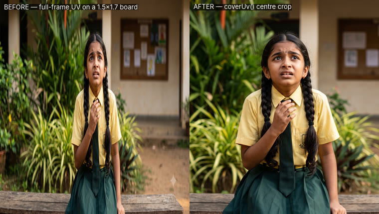

# Expert Review — Emotion Identification VR pair (Emotion Room 360 · Emotion Cinema 360)

**Date:** 2026-11-17 · **Reviewed against:** `claude/bold-euler-2847un` @ `d014fcf`
**Lenses:** VR game development · UI/UX · autism accessibility · pedagogy & measurement
**Companion to:** `docs/joint-attention-360-review-2026-11-15.md` and
`docs/vr-games-expert-review.md`. Several fixes shipped for the joint-attention pair were
**not** carried across to these two games; those are flagged as regressions below.

| | Emotion Room 360 (`emotionrecognition360`) | Emotion Cinema 360 (`identifyemotions360`) |
|---|---|---|
| Construct | Emotion recognition from **static faces**, with a scan | Emotion naming from **dynamic clips** + cause ("why?") |
| Loop | Hear "Who feels ___?", turn to scan 2–3 face-boards, tap the right person | Watch a clip, it freezes on the expressive frame, tap the feeling; Hard adds "why?" |
| Files | `src/games/emotionrecognition360/` | `src/games/identifyemotions360/` |

## Method

- Full read of both games (`logic.ts`, `*Game.tsx`, `*Scene.tsx`, `strings.ts`, `xrStore.ts`),
  the shared quiz/content layer they reuse (`emotionrecognition/content.ts`,
  `identifyemotions/logic.ts`, `emotionVocab.ts`) and the shared VR layer (`headAim.ts`,
  `HeadSelect.tsx`, `hudAnchor.ts`, `VRHudAnchor.tsx`, `VRStarBurst.tsx`, `xrInput.ts`,
  `confirmTracking.ts`, `headTracking.ts`, `useGameAnalytics.ts`, `state/settings.ts`,
  `services/{sounds,speech}.ts`), plus `server/app/scoring.py`.
- `npx tsc -b` → clean. `npx vitest run` → **527/527 pass, 56 files**.
- Both games rendered and played in headless Chromium with the WebGL context instrumented to
  count real `drawElements`/`drawArrays`, `texStorage2D`/`texImage2D`/`texSubImage2D` uploads
  and shader compiles per frame and across a round transition.
- All 24 clips analysed with `ffmpeg`: per-frame mean luminance (flash detection) and EBU R128
  integrated loudness.
- All 25 face photos measured for pixel dimensions and aspect.
- Angular geometry computed from the shipped constants (reproduced inline below).

> **Status.** **C1 is fixed** (commit below); everything else here is as found at `d014fcf`.
>
> **Caveat on the screenshots.** The headless renderer is SwiftShader (software), so frame
> rates and fill costs there mean nothing. Draw-call counts, texture-upload byte counts and
> shader-compile counts are real; everything about *feel* on a Quest needs the device.

---

## 1. Strengths

**The measurement design is the strongest part of these two games, and it is deliberate.**

- Stratified targets (`buildTargets`, `sampleClips`): every available emotion is asked before
  any repeats, and the same emotion never lands on two consecutive rounds.
- Tiered distractors (`pickDistractors`) make "level" a *perceptual-difficulty* construct —
  fear↔surprise, anger↔disgust — not an arbitrary knob. Emotion Cinema additionally manipulates
  **expression intensity** with a separate slow-build Hard footage pool and a per-clip
  `earlyTime`, rather than pausing the same clip sooner. That is the correct dynamic-morph
  design and it is well argued in the file header.
- **Answer position is counterbalanced.** `buildAnswerSlots` / `answerSlots` deal the correct
  slot in shuffled cycles with a seam fix, so a session sweeps every board/card position evenly.
  Without this the `targetBearingDeg` measure would be biased by the shuffle; the code says so.
- **Two latencies per trial.** `latencyMs` from stimulus onset and `latencyFromPromptEndMs` from
  the end of the spoken question, with a `promptTok` guard so a later round's utterance cannot
  back-date the stamp. The question's length varies by emotion word and by language; measuring
  only from onset would have confounded the Malayalam arm. This is careful work.
- `chance` is recorded on every Emotion Room answer and the server scores it through
  `_payload_chance_trials`; Cinema's first-attempt rule (`attempt in {None,1}`) is enforced
  server-side in `_clips_trials` so the retry scaffold cannot inflate accuracy.
- Dwell cost is separated from the attention measure: `beginHeadWindow` opens a
  `confirmTracking` window at stimulus onset and `useGameAnalytics` stamps `dwellArmCount`,
  `dwellConfirmBreaks`, `dwellArmToConfirmMs` and `dwellProfile` onto **every** step. The motor
  cost of confirming is a separate term, not baked into latency.
- Emotion Cinema's retry now pays 5 instead of 0 (`POINTS.retry`), with an explicit note that
  stars, `game_progress` and `_clips_trials` still count first-try only. Child-facing
  no-fail economy, analysis-facing strictness — exactly right.

**Equal salience by construction.** Every face-board stands on a circle of radius 4.2 m
centred on the child, and every answer card on a circle of radius 2.5 m. Both face the child.
So unlike Museum 360 — whose exhibits sit on an arc centred on the *avatar*, giving the centre
option a 55% apparent-size advantage (review C4, left open) — these two games have **no
salience asymmetry to confound the forced choice**. Computed tap-target half-angles:

| | Emotion Room | Emotion Cinema |
|---|---|---|
| Target angular width | 25.8° (identical for every board) | 15.0° (identical for every card) |
| Hit boxes overlap? | **No** — 6.2° clear at 3 boards, 18.2° at 2 | **No** — 0.96° clear (see C4) |

**VR comfort and safety are handled correctly, and mostly by design rather than mitigation.**

- The camera **never translates** in either game. No locomotion, no teleport
  (`teleportPointer: false`), no vection. Everything is a head turn.
- `frameRate: 'low'` deliberately requests the headset's lowest refresh rate with a clear-eyed
  comment about reprojection making input sampling feel late; `foveation: 1` pinned so a
  browser update cannot move the frame budget under the study; `FLAT_SCREEN_DPR` capped at 1.5.
- Damped look controls (`k = min(1, dt*9)`), pitch clamped to ±23–24°, and the drag controls
  stand down entirely inside a session (`if (state.gl.xr.isPresenting) return`).
- `VRWaitingRoom` + `awaitingVr`: pressing Play on a VR-capable browser does **not** start the
  round — the clip never plays and the boards never appear until the child is actually
  presenting. This is a genuinely good piece of protocol hygiene that several commercial VR
  therapy apps get wrong, and it keeps trial 1 from being half-missed.
- `VRQuitButton` is controller-only and parked at −80° / −74°, well outside the play arc.
- Results stay inside VR (`useVrGameOverPanel`) rather than ending the session and dropping the
  child into the Quest home environment.
- `VRPracticeScene` runs once before a child's first real session so headset novelty is not
  confounded with the skill being measured.

**The gaze-confirm reasoning is per-game and correct in principle.** Both games use a
two-stage arm → confirm with the chip parked **off** the option (`"below"` in Room, `"above"`
in Cinema) rather than the `"on"` default, with the right justification: here *looking at the
options is the task*, so a confirm sitting on the line of sight would let a glance at the right
face answer before the child has decided. `coneLimit` (half the angle from the candidate's
centre to the chip) stops the tolerance cone reaching back to the face. Emotion Cinema's
switch from `"below"` to `"above"` after a neck-strain report is the right call.

**Emotion Cinema's media handling has two things specifically right:**

- The frozen frame costs **zero** texture uploads per frame (measured: 15 uploads/15 frames
  while playing, **0** uploads/16 frames while frozen) — the picture the child is being asked
  about is not being re-pushed to the GPU while they think about it.
- A `visibilitychange` handler pauses the clip when the page goes out of sight and resumes it
  **only if it had not reached its freeze yet**, with a comment explaining the incident it came
  from. A `<video>` is not throttled while hidden; this is exactly the right guard.
- The in-world "Watch again" card exists so a child in a headset does not have to pay an error
  to see the clip twice, and the in-world "Next" card exists because the DOM Next button is
  invisible in a headset. Both were real holes, and both are closed.

**Draw calls are already fine — measured, not assumed.** Do not spend effort here.

| Scene | Draw calls / frame | Shader compiles in steady state |
|---|---|---|
| Emotion Room 360 (hard, 3 boards) | **18** | 0 |
| Emotion Cinema 360 (hard, 4 cards) | **22** | 0 |

---

## 2. Critical issues

### C1 — Emotion Room 360 renders every face geometrically distorted `[MEASURED]` `[FIXED 2026-11-17]`

**This is the most serious finding in either game, because it corrupts the stimulus itself.**

`EmotionRecognition360Scene.tsx:451` maps each photo onto the board with default plane UVs:

```tsx
<mesh position={[0, BOARD_Y, 0.02]}>
  <planeGeometry args={[BOARD_W, BOARD_H]} />          {/* 1.5 x 1.7 -> aspect 0.882 */}
  <meshBasicMaterial map={texture} transparent opacity={faceOpacity} toneMapped={false} />
</mesh>
```

Three.js stretches the whole frame to the plane. The photos are **not** the plane's aspect, and
they are not even one aspect among themselves:

| Source size | Aspect | Horizontal compression on the board | Files |
|---|---|---|---|
| 2816 × 1536 | 1.833 | **2.08×** | **13 of 25** |
| 1402 × 1122 | 1.250 | 1.42× | 4 |
| 1254 × 1254 | 1.000 | 1.13× | 4 |
| 512 × 512 / 500 × 500 | 1.000 | 1.13× | 4 |

The scene comment says the board is *"near-square so portrait face photos don't distort"* — but
over half the pool is **landscape**, so the near-square plane is the worst possible choice for it.

Rendered head-on from the child's position, before and after the fix:



Three consequences, in severity order:

1. **The dependent variable is a distorted stimulus.** Emotion recognition from a static face is
   read off the geometry of the face: mouth width and curvature, eye aperture, brow angle,
   nasolabial shape. A 2.08× horizontal squeeze changes every one of those. The child is being
   scored on their ability to read an expression that is not the expression on the photograph.
2. **The distortion varies randomly, trial to trial, within an emotion.** `makeRound` draws
   `pick(singleImagesFor(emotion), rng)` — so "happy" is sometimes a 1.13× photo
   (`HappyFace.png`, 512²) and sometimes a 2.08× one (`Happy_Girl.png`, 2816×1536). Stimulus
   distortion is therefore an uncontrolled, unlogged, within-subject variable sitting directly
   on the primary measure.
3. **The 2D↔360 comparison is invalid as it stands.** The flat game renders the same files
   through `.emotion-display-img { object-fit: contain }` (`global.css:294`) — undistorted. The
   two builds are not presenting the same stimulus, so any Desktop-vs-VR difference partly
   measures this bug. `docs/study-blueprint-buds.md` treats the pair as the same task.

Fix in §4.1. **Nothing else in this review matters as much as this one.**

> **Resolved 2026-11-17 — the code half of §4.1 only.** `coverUv` now centre-crops each photo
> to the board's aspect instead of letting the plane squeeze it, so every face renders at its
> true proportions whatever shape the source file is. Verified three ways: five unit tests
> covering the three shipped shapes plus two extremes and the undecoded-image fallback; a test
> that reads the real PNG headers and fails if a future asset would lose more than 60% of its
> frame to the crop; and every one of the 25 photos rendered at the crop and checked by eye —
> **all 25 keep the face fully in frame, centred, with room to spare** (the tightest keeps 48%
> of its pixels). See `docs/emotion-360-cover-crops.jpg`.
>
> Two things this did **not** do, deliberately:
>
> - **The assets are untouched**, so **C6 (per-round texture churn) is still open** — the fix
>   changes which part of each 2816×1536 texture is sampled, not how big it is or how often it
>   is uploaded. §4.2 is still the fix for that.
> - **The framing now differs between builds**, where before the *geometry* did. The 360 board
>   shows a centre crop and the flat twin still shows the whole frame
>   (`object-fit: contain`). Both are undistorted, which is the part that mattered, but they
>   are not identical stimuli. Closing that gap means re-cropping the source files so both
>   builds show the same thing — which changes the flat game's stimuli too, and is a study-design
>   call rather than a bug fix, so it is left to the researcher (§4.1, second half).
>
> A side benefit worth noting against **D3**: the crop discards the left and right thirds of
> each photo, which in this pool is unrelated room background — including the weather poster
> sitting beside the sad child.

### C2 — The video clips' audio is outside the mute and volume system entirely `[MEASURED]`

`IdentifyEmotions360Game.tsx:88-97` creates the `<video>` with a comment that it is deliberately
unmuted, "the clips' audio (reactions, exclamations) is part of the cue":

```tsx
const [videoEl] = useState<HTMLVideoElement>(() => {
  const v = document.createElement('video')
  v.playsInline = true
  v.setAttribute('playsinline', '')
  v.preload = 'auto'
  return v
})
```

`videoEl.muted` and `videoEl.volume` are **never set, anywhere in the codebase.** Three problems
fall out of that, and the third is measurable.

1. **`soundOn` does not gate it.** A trainer who switches sound off for a sound-sensitive child —
   the only sensory lever the app has — silences the chimes and the praise clips and gets the
   clip audio at full system volume anyway. For an autistic child in a headset, the one control
   the adult has does not control the loudest thing in the game.
2. **There is no volume at all.** `state/settings.ts` has `voiceOn`/`soundOn` as booleans and
   nothing else, and `remote/commands.ts` can patch only `voiceOn`, `soundOn`, `language`,
   `inputMethod`, `dwellProfile`. So there is no way, from the headset or the trainer's phone,
   to turn the clips down.
3. **The clips are not loudness-matched, and the spread is enormous.** EBU R128 integrated
   loudness across all 24:

   | | quietest | loudest | spread |
   |---|---|---|---|
   | All 24 clips | `disgust_hard_2` −53.8 LUFS | `happy_2` −12.5 LUFS | **41.3 dB** |
   | Hard pool only (the intensity manipulation) | `disgust_hard_2` −53.8 | `fear_hard_2` −19.5 | **34.3 dB** |

   Eight of 24 sit below −32 LUFS — effectively inaudible at any sane playback level, so the
   "audio is part of the cue" claim is false for a third of the stimulus set. At a level set
   comfortably for those, `happy_2` arrives **41 dB louder** — roughly a hundredfold jump in
   sound pressure, unannounced, in a headset. That is a startle/adverse-event risk with no
   mitigation available to the adult in the room, and it is simultaneously a **stimulus-control
   problem**: auditory salience is confounded with clip identity and therefore with emotion.

**Related, and worth knowing even though it does *not* breach the photosensitivity threshold.**
I measured per-frame mean luminance for all 24 clips. Two have large single-frame full-field
transitions:

- `fear_hard_1` — **+48/255 (19% of full scale) in 84 ms** at t ≈ 0.96–1.00 s, then decaying over
  ~0.4 s. This is the lightning strike visible in the screenshot. Its Hard freeze is at
  `earlyTime: 1.5`, so the flash fires **0.5 s before the frame the child is asked about**, on
  every presentation of that clip, with the thunder at −23.3 LUFS.
- `angry_1` — **−67/255 (26%) in a single frame** at t = 1.000 s (a hard cut to near-black),
  ramping back over 8 frames.

Neither is a repeated flash, so **neither crosses the WCAG/Harding ≥3-flashes-per-second
photosensitive-epilepsy threshold** — I want to be precise about that. But a 19% full-field
brightening across a 39°-wide screen in a headset, with no warning, no way to turn it down and
no way to skip it, is a sensory-startle risk for precisely this population, and it lands on the
*fear* trials where the child is already being shown a frightening expression.

### C3 — Two human voices talk over each other on every correct answer (both games) `[REGRESSION]`

The joint-attention review's **C3** was fixed on 2026-11-15 by adding `speakThenPraise`
(`services/speech.ts:106`). It is used in `museum360` and `park360` and **nowhere else**:

```
$ grep -rn speakThenPraise src/
src/services/speech.ts:106 …
src/games/museum360/Museum360Game.tsx:236,243
src/games/park360/Park360Game.tsx:367
```

Both emotion games still have the original pattern. `praise()` is a pre-recorded WebAudio clip
and `speak()` is `speechSynthesis` — different subsystems, so they do not cancel each other:

```tsx
// EmotionRecognition360Game.tsx:244-246
playSuccess()                               // 3-note chord
speak(roomLine('sayCorrect', lang), lang)   // "Yes! Well done!"   (speechSynthesis)
praise()                                    // "Great job!"        (WebAudio clip)
```

Emotion Cinema is worse — it starts a **third** stream, the clip's own unmuted audio:

```tsx
// IdentifyEmotions360Game.tsx:298-301
playSuccess()
praise()
void videoEl.play().catch(() => {})         // the clip resumes, with its audio
```

and on a wrong answer the replay comes back over the top of the spoken correction:

```tsx
// :320-325
playGentle()
speak(clipLine('sayLookAgain', lang), lang)      // ~1.4 s at rate 0.9
replayTimer.current = setTimeout(replay, 900)    // clip audio starts ~500 ms before it ends
```

For an auditory-hypersensitive child this is an overload risk; for a child with receptive-language
difficulty it makes the label — the one piece of vocabulary teaching in the game — unintelligible
at the exact moment it is being reinforced. Fix in §4.3.

### C4 — Emotion Cinema's answer cards leave 0.96° of clear space between neighbours

From the shipped constants (`identifyemotions360/logic.ts`): `CARD_RADIUS = 2.5`,
`CARD_STEP_DEG = 16`, card `width = 0.66`.

```
card half-angle  = atan(0.33 / 2.5)        = 7.52°
edge-to-edge gap = 16 − 2 × 7.52           = 0.96°   (≈ 4.2 cm at 2.5 m)
```

| n | bearings | outermost edge |
|---|---|---|
| 2 (easy) | −8, +8 | 15.5° |
| 3 (medium) | −16, 0, +16 | 23.5° |
| 4 (hard) | −24, −8, +8, +24 | 31.5° |

The guard band is **under one degree at every level**, which is inside ordinary postural sway
for a 7–10 year-old and inside the ray jitter of a hand-held controller at that range.

To be fair about the severity: this is **not** the Museum 360 failure mode. The hit boxes do not
overlap, so no bearing can reach two cards, and the two-stage arm → confirm means a mis-arm is
*visible* (the ✓ chip appears above the wrong card) and recoverable before anything is answered.
The cost is not silent wrong answers — it is re-arming, a chip that jumps sideways while the
child tries to look at it, and a motor tax that lands hardest on exactly the children the dwell
forgiveness in `headAim.ts` exists for.

**You can already see this in the data you collect.** `useGameAnalytics` stamps `dwellArmCount`
and `dwellConfirmBreaks` on every step. Compare Cinema hard (0.96° gaps) against Room hard
(6.2° gaps) for the same children: if the crowding is costing what I think it is, Cinema's
`dwellArmCount` will be visibly higher at matched `dwellProfile`. Fix in §4.4.

### C5 — Emotion Room's confirm chip parks 10 cm below the floor, 21° down

`HeadSelect`'s `"below"` branch puts the chip under the candidate's bounding box:

```ts
chip.position.y = box.min.y − dist × CHIP_ANGULAR × confirmGap
```

With Emotion Room's shipped numbers — tap target `1.9 × 2.1` centred at `BOARD_Y = 1.45`, so
`box.min.y = 0.40`; distance ≈ 4.15 m; `CHIP_ANGULAR = 0.11`; `DEFAULT_GAP_BELOW = 1.1`:

```
chip.y = 0.40 − 4.15 × 0.11 × 1.1 = −0.102 m        (the floor is at y = 0)
```

The chip renders anyway — its material is `depthTest: false`, `renderOrder: 998` — so it is
drawn over the floor disc rather than hidden by it. Two problems:

1. **It is below the floor.** A ✓ floating under the floor plane but painted on top of it has no
   coherent depth, which is a disorienting thing to ask a child to fixate on in stereo.
2. **The angle.** To confirm, the child looks **21.1° down** (16.8° for a 1.15 m eye height) and
   *holds* there for the full dwell — 0.7 s on `high-support`, 1.6 s on `standard`. Meanwhile
   the in-world question panel they are answering sits at **21.4° up** (22.6° at 1.15 m, after
   `minOffsetY: -0.25` clamps the HUD's drop).

So one Emotion Room trial asks for a **~39–43° vertical sweep**, 6–10 times per session, with a
sustained hold in neck flexion at the bottom of it. `HeadSelect`'s own documentation calls
`"below"` *"the worst case for a child with poor head control, exactly the children the dwell
forgiveness in `headAim.ts` exists for"*. `hudAnchor.ts` separately warns that *"sustained upward
gaze past ~20–25° is the uncomfortable direction"*. Both halves of that warning are being
violated in the same trial. Fix in §4.5.

*(Note: `HeadSelect.tsx`'s header still says "The two emotion games … use [`below`]". Cinema was
moved to `"above"` and the doc was not updated — see D8.)*

### C6 — Emotion Room re-uploads 40–96 MB of textures at every round transition `[MEASURED]`

`FaceBoard` builds a fresh texture per mount, and `BoardRow` re-keys every board each round
(`key={`${b.imageSrc}-${i}`}`), so every round tears down three textures and uploads three new
ones. `THREE.Cache.enabled` is never set, so the images are re-fetched and re-decoded too.

Measured across one answer → next round's boards appearing, on Hard:

```
ROUND TRANSITION: 3 texture uploads, 95.7 MB, 2 shader compiles
   sizes: ["1402x1122+mips", "2816x1536+mips", "2816x1536+mips"]
   (a second run of the same transition: 40.0 MB — it varies with which photos are drawn)
```

Steady state is clean (18 draws/frame, 0 compiles), so **all** the cost is the transition. Over
a 10-round Hard session that is roughly **0.4–1 GB of texture allocation, mipmap generation and
upload traffic**, in ten bursts on the main thread, each with a pipeline stall attached.

For contrast, the joint-attention review's equivalent measurement reads: *"Zero shader compiles
during play means the per-round exhibit remount causes **no** mid-session pipeline hitch."*
Emotion Room 360 fails that test on both counts.

The textures are also far larger than anything the display can show. The board subtends
20.2° × 22.9°; a Quest 3 resolves roughly 20 px/°, so the board is ~404 × 458 device pixels. A
2816 × 1536 source is **7× wider than the panel can display**, and three.js is generating a full
mip chain for it on the fly, every round. Fix in §4.2 — which also fixes C1.

---

## 3. Design & UX recommendations

**D1 — Ship a sensory profile. Still the biggest gap, and now a bigger one than in November.**
`state/settings.ts` exposes `voiceOn`/`soundOn` as booleans only: no volume, no speech rate, no
stimulation level. `prefers-reduced-motion` appears **once** in `global.css` and in **zero** of
the 7 `useFrame` animation loops in these two scenes. These two games make the gap worse than the
joint-attention pair did, because Emotion Cinema adds an audio stream (C2) that is outside even
the boolean. Concretely, and unavoidably:

- `VRStarBurst` pops a `toneMapped={false}` gold star **2.6 m in front of wherever the child is
  looking** on every correct answer, wobbling at `sin(dt*11)` ≈ 1.75 Hz. In Cinema the answer
  cards are at 2.5 m, so the star lands roughly **on top of the card row**, ~24° wide, at the
  same moment the clip's audio resumes and the praise clip and the chime play.
- Cinema fires `<Celebration />` (a spinning octahedron, `sin(t*6)` ≈ 0.95 Hz) **and**
  `VRStarBurst` together.
- Room's hint ring pulses at `sin(t*3)` ≈ 0.48 Hz and the correct-board sparkle spins and
  throbs at `sin(t*5)` ≈ 0.8 Hz.

Nothing here is near the photosensitivity threshold — the fastest periodic element is 1.75 Hz —
and none of it can be turned down. Add `sensoryLevel: 'full' | 'calm' | 'minimal'` and
`volume: number` to settings, wire them into the existing trainer-remote patch channel
(`remote/commands.ts:46-50` already passes five fields live — add two more), and consume them in
`sounds.ts`, `videoEl.volume`, and a shared `useMotionScale()` the scene loops multiply into
their animation terms. Keep *something* on every correct answer at `minimal`; the goal is turning
the volume down, not removing reinforcement.

**D2 — Put the question where the answer is.** Both games separate the prompt from the response
by a large vertical angle, measured from the shipped constants:

| | question (in-world HUD) | response | excursion |
|---|---|---|---|
| Emotion Room, 1.5 m eye | +21.4° | confirm chip −21.1° | **42.5°** |
| Emotion Room, 1.15 m eye | +22.6° | confirm chip −16.8° | **39.4°** |
| Emotion Cinema, 1.5 m eye | +19.8° | cards −16.7° | **36.5°** |
| Emotion Cinema, 1.15 m eye | +19.8° | cards −9.1° | **28.9°** |

Inside a headset the DOM `PromptBanner` is invisible, so the in-world panel is the *only* written
form of the question — a child who needs to re-read it must make the full sweep. The score panel
is higher still (26.9–29.7°). `VRHudAnchor` mitigates by sliding the HUD to the wearer's real eye
height, but Room clamps that at `minOffsetY: -0.25` (because the panels would otherwise sink into
the boards), so a short child keeps most of the elevation. Options, cheapest first: drop the
*score* panel out of the headset view entirely (it is not task information — it is for the adult,
who has the phone remote); move the prompt panel **down and nearer**, below the score rather than
above it; or give Room the same `"above"` confirm side Cinema already uses, which removes the
bottom half of its excursion on its own.

**D3 — The face photos carry background context that competes with, and sometimes cues, the
face.** The stimulus set is photoreal, full-scene, with a *different* background per board —
curtains and a weather poster behind one child, a kitchen behind another, a doorway and a potted
plant behind a third (see `emotion-room-360-play.png`). Two issues: (a) three unrelated,
detailed backgrounds side by side is a lot of competing visual information for a task that is
about comparing three faces, and local-detail-over-global-gestalt processing is a well-described
feature of this population; (b) at least one background is **semantically congruent** with its
emotion (a rain/cloud image beside the sad child), which is a route to the right answer that does
not involve reading a face at all. Re-cropping to head-and-shoulders on a neutral ground fixes
both — and §4.2 is re-cropping the assets anyway, so this is close to free.

**D4 — Neither game logs a non-response, and Cinema logs no replays.** The event vocabulary for
these two games is `event_ready`, `hint`, `answer`, `cause_answer`, `level_result`. There is:

- **no no-response event.** Emotion Room Hard has `hintAfterMs: null` and Cinema has no timeout
  at all, so a child who never answers sits on a frozen frame or a board row indefinitely, in
  silence, with nothing recorded. Park 360 at least emits `no_share`. A trial where the child
  never responded is currently indistinguishable in the data from a session that simply ended —
  and "did not respond" is clinically the most interesting category.
- **no replay event.** `replay()` serves both the automatic post-error replay *and* the child's
  voluntary "Watch again" — the in-world card that was added specifically so children could
  re-watch in a headset. Voluntary re-watching is a real behavioural measure (information
  seeking under uncertainty) and it produces no data at all.
- **no freeze/trial-onset event in Cinema**, unlike Room's `event_ready`. There is no record of
  when the freeze happened or how long the clip took to get there.
- Cinema's `level_result` omits `chance` (Room records it), even though Cinema's chance varies
  1/2 → 1/3 → 1/4 by level. The server fills it from `CLIPS_CHANCE`, but the step itself is not
  self-describing the way Room's is.

See §4.6 for all four — they are small additions and they close a real hole in the dataset.

**D5 — Emotion Cinema's answer cards appear without warning, mid-task.** `AnswerLayer` returns
`null` until `frozen`, so four cards pop into existence at the instant the picture freezes.
Predictability is a core autism-friendly principle and the rest of this codebase respects it
(Room's `ROUND_GAP_MS` "calm beat" is exactly the right instinct). Consider fading the cards in
over ~300 ms, or — better — showing them greyed from the start of the clip so the child knows
what is coming and where, and enabling them at the freeze.

**D6 — The flat/demo build clips the hard levels.** With `fov: 60` vertical, the horizontal FOV
is 91.6° at 16:9 but only **35.8° at 9:16**. Emotion Room Hard reaches ±44.9° at the tap-target
edges; Cinema Hard's cards reach ±31.5° and the "Watch again" card spans 33.8–50.2°. On a phone
in portrait, half the options are off-screen at the start of every trial. Even in landscape, the
headless render at 1280×720 shows Cinema's **answer-card labels cut off by the bottom of the
canvas** — the child sees emoji only, no words (`emotion-cinema-360-play.png`). The VR build is
the intervention, so this is a demo-path issue — but it is the build the familiarisation sessions
run on, and "the words were missing in the practice session" is not a confound you want.

**D7 — Note the ceiling on Cinema Hard's confusability manipulation.** `CONFUSABLE_WITH` gives
each emotion 1–3 confusable neighbours out of a 6-emotion vocabulary. `pickDistractors(…, 'high')`
guarantees **one** confusable distractor and fills the rest at random. With `CHOICE_COUNT.hard =
4`, three of the five remaining emotions must be used, so two of the three distractors are
typically *not* confusable — and for `happy` (whose only neighbour is `surprised`) they cannot
be. Emotion Room Hard, with 3 boards and 2 distractors, gets a much purer manipulation. This is
not a bug, but it means "Hard" means something measurably different in the two games, and the
Cinema Hard trials are easier than the design intends. Either report it as a limitation or
consider 3 choices on Cinema Hard, letting the `early`-freeze intensity manipulation carry the
difficulty on its own.

**D8 — Stale documentation in `HeadSelect.tsx`.** Its header states *"The two emotion games
(Emotion Room 360, Emotion Cinema 360) use [`confirmSide="below"`]"*. Cinema uses `"above"`
(`IdentifyEmotions360Scene.tsx:110`), explicitly because a downward look strained the neck. One
of the two statements should move. Relatedly, `emotionrecognition360/logic.ts` declares
`FRONT_HALF_ARC_DEG = 40` and `logic.test.ts:34` asserts the board *centres* respect it — but the
tap targets reach 44.9°, so the declared playable arc does not cover what the child actually has
to turn to.

---

## 4. Code optimisation & fixes

### 4.1 — Stop distorting the faces (fixes C1)

> **Shipped 2026-11-17**, as the first half below. The asset re-authoring in the second half is
> still open and still the better end state — it is what would also close C6 and make the two
> builds show the same stimulus.

The minimal, immediate fix is a cover-fit on the texture, so the board crops the photo instead of
squeezing it:

```ts
// emotionrecognition360/logic.ts — pure, so it is unit-testable
/** Crop a texture to `planeAspect` instead of stretching the frame to it.
 *  A face is the measurement in this game, so its geometry has to survive the
 *  board: a 2816x1536 photo on a 1.5x1.7 plane was 2.08x too narrow. */
export function coverFit(tex: THREE.Texture, planeAspect: number): void {
  const img = tex.image as { width?: number; height?: number } | undefined
  if (!img?.width || !img?.height) return
  const imgAspect = img.width / img.height
  if (imgAspect > planeAspect) {
    const r = planeAspect / imgAspect
    tex.repeat.set(r, 1)
    tex.offset.set((1 - r) / 2, 0)
  } else {
    const r = imgAspect / planeAspect
    tex.repeat.set(1, r)
    tex.offset.set(0, (1 - r) / 2)
  }
  tex.needsUpdate = true
}
```

```tsx
// EmotionRecognition360Scene.tsx — FaceBoard
  const texture = useMemo(() => {
-   const tex = new THREE.TextureLoader().load(board.imageSrc)
+   const tex = new THREE.TextureLoader().load(board.imageSrc, (t) =>
+     coverFit(t, BOARD_W / BOARD_H),
+   )
    tex.colorSpace = THREE.SRGBColorSpace
    tex.anisotropy = gl.capabilities.getMaxAnisotropy()
    return tex
  }, [board.imageSrc, gl])
```

**But the right fix is on the assets, and it also fixes C6 and D3.** A centre crop of a 1.83:1
photo throws away 52% of the width, and nothing guarantees the face is centred in all 25 files —
on `Fear_Girl_3.png` it is, but that is luck, not a property of the set. Re-author the stimulus
pool once, offline, to a single face-centred crop at the board's aspect and a sane resolution:

```bash
# one aspect (0.882), head-and-shoulders, ~2x the pixels the panel can show.
# Check each crop by eye — these are the study's stimuli, not decoration.
for f in public/emotions/*.png; do
  ffmpeg -y -i "$f" -vf "crop=ih*0.882:ih,scale=1024:1160" -c:v libwebp -quality 88 \
    "public/emotions/std/$(basename "${f%.png}").webp"
done
```

1024 × 1160 is ~2.5× the panel's device pixels, 4.75 MB on the GPU instead of 17.3 MB + mips, and
roughly 150 kB on disk instead of 6.9 MB — which also materially shortens the offline precache
(`scripts/gen-offline-manifest.mjs` currently ships ~116 MB of `emotions/` alone). Keep
`coverFit` in as a guard so a later asset with the wrong aspect degrades to a crop rather than a
squeeze, and add a test:

```ts
it('never stretches a face: every photo crops to the board aspect', async () => {
  for (const id of AVAILABLE_EMOTIONS)
    for (const img of singleImagesFor(id)) {
      const { width, height } = await probe(img.src)
      expect(Math.abs(width / height - BOARD_W / BOARD_H)).toBeLessThan(0.02)
    }
})
```

### 4.2 — Upload each face once per session, not once per round (fixes C6)

```ts
// emotionrecognition360/textures.ts — new
/** One GPU texture per photo per game entry.
 *  `BoardRow` re-keys its boards every round, so the per-component useMemo was
 *  tearing down and re-uploading three textures (40-96 MB, measured) with a
 *  fresh mip chain at every round transition. */
const cache = new Map<string, THREE.Texture>()

export function faceTexture(src: string, anisotropy: number): THREE.Texture {
  let tex = cache.get(src)
  if (tex === undefined) {
    tex = new THREE.TextureLoader().load(src, (t) => coverFit(t, BOARD_W / BOARD_H))
    tex.colorSpace = THREE.SRGBColorSpace
    tex.anisotropy = anisotropy
    cache.set(src, tex)
  }
  return tex
}

/** Call once when the game unmounts — never per round. */
export function disposeFaceTextures(): void {
  for (const tex of cache.values()) tex.dispose()
  cache.clear()
}
```

```tsx
// EmotionRecognition360Scene.tsx — FaceBoard
- const texture = useMemo(() => { … }, [board.imageSrc, gl])
- useEffect(() => () => texture.dispose(), [texture])
+ const texture = faceTexture(board.imageSrc, gl.capabilities.getMaxAnisotropy())

// …and once, at the scene root:
+ useEffect(() => () => disposeFaceTextures(), [])
```

With the re-cropped assets of §4.1 the whole pool is ~119 MB of VRAM if every photo is touched —
still too much to hold all at once, so cap the cache (LRU, ~8 entries) or preload only the
emotions this session's `buildTargets` will actually ask for. Either way the per-round upload
goes to zero for repeats, which is most of them.

### 4.3 — Sequence the reinforcement audio (fixes C3)

```tsx
// EmotionRecognition360Game.tsx — pick()
- import { praise, speak } from '../../services/speech'
+ import { speak, speakThenPraise } from '../../services/speech'
  …
  if (correct) {
    playSuccess()
-   speak(roomLine('sayCorrect', lang), lang)
-   praise()
+   // one voice at a time: speak() is speechSynthesis and praise() is a WebAudio
+   // clip, so calling both started two people talking at once (review C3)
+   speakThenPraise(roomLine('sayCorrect', lang), lang)
  } else {
```

```tsx
// IdentifyEmotions360Game.tsx — pick(), correct branch
+ /** the pause that lets the cheer finish before the clip's own audio returns */
+ const resumeTimer = useRef<ReturnType<typeof setTimeout> | null>(null)
  …
    playSuccess()
    praise()
-   void videoEl.play().catch(() => {})
+   resumeTimer.current = setTimeout(() => { void videoEl.play().catch(() => {}) }, 700)
```

```tsx
// IdentifyEmotions360Game.tsx — pick(), wrong branch
    playGentle()
-   speak(clipLine('sayLookAgain', lang), lang)
    firstTryRef.current = false
    setWrong((w) => [...w, id])
-   replayTimer.current = setTimeout(replay, REPLAY_DELAY_MS)
+   // "Let's look again", THEN the clip — not the clip's audio over the top of
+   // the correction. speak()'s onEnd fires synchronously when speech is off or
+   // unavailable (every standalone VR browser), so the replay still lands there.
+   const tok = ++replayTok.current
+   speak(clipLine('sayLookAgain', lang), lang, () => {
+     if (replayTok.current !== tok) return
+     replayTimer.current = setTimeout(replay, 250)
+   })
```

Add `resumeTimer` and `replayTimer` to `clearTimers()`, and `replayTok` as a `useRef(0)` reset in
`startQuestion`.

Then gate the clip's audio on the settings it should always have been gated on (C2):

```tsx
// IdentifyEmotions360Game.tsx — next to the <video> creation
+ // The clips' audio is the loudest thing in this game and was the only sound in
+ // the app outside `soundOn`: a trainer who muted for a sound-sensitive child
+ // still got it at full volume (review C2).
+ useEffect(() => {
+   const apply = () => {
+     const { soundOn, volume } = useSettings.getState()
+     videoEl.muted = !soundOn
+     videoEl.volume = Math.min(1, Math.max(0, volume))
+   }
+   apply()
+   return useSettings.subscribe(apply)
+ }, [videoEl])
```

and loudness-match the stimulus set once, offline, so auditory salience stops varying 41 dB
across clips:

```bash
for f in public/videos/*.mp4; do
  ffmpeg -y -i "$f" -af loudnorm=I=-23:TP=-2:LRA=7 -c:v copy "${f%.mp4}.norm.mp4"
done
```

Re-measure with `ffmpeg -i … -af ebur128 -f null -` afterwards; the eight clips currently below
−32 LUFS will come up to audible, which is what the design claims they already are.

### 4.4 — Give Emotion Cinema's answer cards a real guard band (fixes C4)

```ts
// identifyemotions360/logic.ts
- /** angular gap between adjacent answer cards */
- export const CARD_STEP_DEG = 16
+ /**
+  * Angular gap between adjacent answer-card CENTRES.
+  *
+  * A 0.66 m card at 2.5 m subtends 15.0 deg, so the old 16 deg step left
+  * 0.96 deg (4.2 cm) of clear space between neighbours — inside a child's
+  * postural sway and inside a controller ray's jitter at that range, so the
+  * armed card flickered while they were still deciding. 22 deg leaves ~7 deg,
+  * and 4 cards still reach only +/-33 deg of centre.
+  */
+ export const CARD_STEP_DEG = 22
```

That pushes Hard's outer card edge from 31.5° to 40.5°, which collides with the "Watch again"
card at 42° (33.8–50.2°). Move the tool card out of the answer row's lateral budget — it is not
an answer and should not compete for the same arc:

```tsx
// IdentifyEmotions360Scene.tsx — AnswerLayer, naming stage
  <TextCard
-   bearingDeg={42}
-   radius={CARD_RADIUS}
-   y={CARD_Y}
+   // Pushed clear of the widest answer row (4 cards reach 40.5 deg at a 22 deg
+   // step) and of the Quit/mode corner on the left. It is a tool, not an
+   // option, so it does not belong inside the choice arc at all.
+   bearingDeg={54}
+   radius={CARD_RADIUS}
+   y={CARD_Y}
```

If 54° is too far a turn on device, the alternative is to keep the step at 16° and shrink the
cards to 0.42 m wide (half-angle 4.8°, gap 6.4°) — but that costs label legibility, which is the
wrong trade in a game where the label *is* the answer. Pilot the 22° row first.

### 4.5 — Lift Emotion Room's confirm chip off the floor (fixes C5)

The simplest change that removes the whole problem is the one Cinema already made:

```tsx
// EmotionRecognition360Scene.tsx
- <HeadSelect confirmSide="below" />
+ {/* "above", not "below": the chip under a board whose hit volume starts at
+     y = 0.40 lands at y = -0.10 — under the floor — and asks for a 21 deg
+     downward look held for the whole dwell, while the question panel sits
+     21 deg UP. "above" keeps the same two-stage separation (a deliberate
+     shift of gaze off the face, with coneLimit stopping the cone reaching
+     back to it) without the neck flexion. Same reasoning as Emotion Cinema. */}
+ <HeadSelect confirmSide="above" />
```

Check the result before shipping: `box.max.y = 2.50`, so the chip lands at
`2.50 + 4.15 × 0.11 × 0.9 = 2.91 m` → **18.6° up** from a 1.5 m eye — which stacks under the
prompt panel at 21.4°. If they crowd, pass `confirmGap={0.6}` to bring the chip in to 2.77 m
(17.0°), or take D2's advice and move the HUD down first.

If you would rather keep `"below"` for the Room (there is a defensible argument that a downward
confirm is the cleanest possible separation from "reading the face"), then at minimum floor the
chip above the ground:

```ts
// HeadSelect.tsx — the non-"on" branch
+ /** Never park the chip below the floor: it has depthTest:false, so it draws
+  *  over the ground with no depth cue, and the look-down angle is already the
+  *  uncomfortable direction. */
+ const MIN_CHIP_Y = 0.25
  chip.current.position.set(
    centre.x,
    confirmSide === 'above'
      ? box.max.y + dist * CHIP_ANGULAR * confirmGap
-     : box.min.y - dist * CHIP_ANGULAR * confirmGap,
+     : Math.max(MIN_CHIP_Y, box.min.y - dist * CHIP_ANGULAR * confirmGap),
    centre.z,
  )
```

Note that `coneLimit` is computed from the chip's final position, so it adapts automatically.

### 4.6 — Close the four data gaps (D4)

```tsx
// IdentifyEmotions360Game.tsx — in the freeze handler, next to beginHeadWindow()
+ recordStep('clip_frozen', {
+   clip: cur.clip.slug,
+   difficulty,
+   freezeKind: cur.freezeKind,
+   freezeTime: cur.freezeTime,
+   actualFreezeTime: videoEl.currentTime,   // see §4.7 — `timeupdate` overshoots
+   choiceCount: cur.choices.length,
+   chance: 1 / cur.choices.length,
+ })
```

```tsx
// IdentifyEmotions360Game.tsx — replay()
- function replay() {
-   if (locked) return
-   playFrom(qRef.current!.clip.src)
- }
+ /** `source: 'child'` is the in-world / DOM "Watch again" card — a voluntary
+  *  re-look, which is a behavioural measure in its own right and was not
+  *  recorded at all. `source: 'scaffold'` is the automatic post-error replay. */
+ function replay(source: 'child' | 'scaffold' = 'child') {
+   const cur = qRef.current
+   if (locked || !cur) return
+   recordStep('replay', { clip: cur.clip.slug, difficulty, source, attempt: attemptRef.current })
+   playFrom(cur.clip.src)
+ }
  …
- replayTimer.current = setTimeout(replay, 250)
+ replayTimer.current = setTimeout(() => replay('scaffold'), 250)
```

```tsx
// both games — a no-response probe, so "did not answer" is a datum, not a silence
+ /** A trial with no response is the clinically most interesting case and was
+  *  invisible in the data. Log it, and — on the levels that have a scaffold —
+  *  re-offer it rather than leaving a child in silence in a headset. */
+ const NO_ANSWER_MS = 20_000
+ noAnswerTimer.current = setTimeout(() => {
+   recordStep('no_answer', { afterMs: NO_ANSWER_MS, target: next.target })
+   if (cfg.hintAfterMs !== null && !hintFiredRef.current) fireHint()
+ }, NO_ANSWER_MS)
```

and add `chance` to Cinema's `level_result` so the step is self-describing like Room's:

```tsx
  recordStep('level_result', {
    difficulty,
    firstTryCorrect: nextFirstTry,
    total,
    accuracy: total > 0 ? nextFirstTry / total : 0,
+   chance: 1 / CHOICE_COUNT[difficulty],
    score: nextScore,
  })
```

### 4.7 — Freeze on the frame you meant to freeze on

`freezeAtTarget` is driven by the `timeupdate` event, which browsers fire roughly every 250 ms:

```tsx
videoEl.addEventListener('timeupdate', freezeAtTarget)
```

So the clip actually stops anywhere in `[freezeTime, freezeTime + ~0.25 s]`. On Easy/Medium, where
the freeze is the *peak*, that is harmless. On **Hard it is not**: `earlyTime` is tuned per clip
to a ~40–50%-intensity frame on a 2 s build (`fear_hard_1: 1.5`, `angry_hard_1: 2`,
`happy_hard_2: 2`), so 250 ms of slop is **up to ~12% of the build** — on the manipulation the
Hard level exists to deliver, varying run to run. `requestVideoFrameCallback` gives per-frame
precision and is available on every browser this ships to:

```tsx
useEffect(() => {
  let handle = 0
  const check = () => {
    const cur = qRef.current
    if (!pausedRef.current && cur) {
      const target = Math.min(cur.freezeTime, (videoEl.duration || cur.freezeTime) - 0.1)
      if (videoEl.currentTime >= target) { /* …pause, stamp, beginHeadWindow, setFrozen… */ }
    }
    if ('requestVideoFrameCallback' in videoEl) handle = videoEl.requestVideoFrameCallback(check)
  }
  if ('requestVideoFrameCallback' in videoEl) handle = videoEl.requestVideoFrameCallback(check)
  else videoEl.addEventListener('timeupdate', check)          // fallback, as today
  return () => {
    if (handle) videoEl.cancelVideoFrameCallback(handle)
    videoEl.removeEventListener('timeupdate', check)
  }
}, [videoEl])
```

Record `actualFreezeTime` either way (§4.6) so the residual slop is measurable rather than assumed.

### 4.8 — Minor correctness

| Where | Issue | Fix |
|---|---|---|
| `EmotionRecognition360Game.tsx:294`, `IdentifyEmotions360Game.tsx:374` | `setTimeout(() => setPhase('over'), 1200)` is untracked; `clearTimers()` covers the other three/two. Same class as the joint-attention review's **C5**, which was fixed for Museum 360 and not here. | Hold it in a ref and clear it in `clearTimers()`. |
| both `advance()` | `speak(…'sayWin')` is fired and nothing cancels `speechSynthesis` on unmount, so quitting during the win line leaves it talking over the Home screen or the next game. | `useEffect(() => () => window.speechSynthesis?.cancel(), [])` in both games. |
| `EmotionRecognition360Scene.tsx:477`, `IdentifyEmotions360Scene.tsx:534` | `document.body.style.cursor = 'pointer'` on hover, reset only in `onPointerOut`. A correct pick advances the round and unmounts the board *while still hovered*, so `onPointerOut` never fires and the hand cursor sticks app-wide. **This exact bug was fixed in `Museum360Scene.tsx:923` and `Park360Scene.tsx:517` and not carried across.** | Copy the unmount reset from `Museum360Scene.tsx:919-923`. |
| `IdentifyEmotions360Scene.tsx:265-274` `BigScreen` | The `VideoTexture` is the **only** texture in these two scene files without a `useEffect(() => () => texture.dispose())` — `TextCard` (:521), `TextPanel` (:626, :326) and `FaceBoard` (:394) all have one. A new one is created per `clipSlug`, so a Hard session leaks 12 GPU textures (~100 MB at 1920×1080 RGBA), freed only when the context dies. | Add the dispose. |
| `IdentifyEmotions360Scene.tsx:276-279` | `useFrame(() => { if (!videoEl.paused) texture.needsUpdate = true })` is redundant: three.js r152+ `VideoTexture` drives itself from `requestVideoFrameCallback`. Measured: 0 uploads while frozen with *and* without it. Harmless, but it reads as the thing keeping the frozen frame cheap, which it is not. | Delete, with a comment saying why it is safe to. |
| `EmotionRecognition360Scene.tsx:408-412` | `frameMat.current.emissiveIntensity += (target - …) * 0.15` is a frame-rate-dependent lerp: the gold warm-up is 25% faster at 90 Hz than at 72 Hz. | `* (1 - Math.exp(-dt * 9))`, matching the damping idiom `LookControls` already uses. |
| `EmotionRecognition360Game.tsx:258` | `answer: round.target` duplicates `target` in the same payload. Harmless but it reads as two different things in the analysis. | Drop one, or comment it. |
| `EmotionRecognition360Game.tsx:268` | `mode: 'practice'` is hard-coded on every answer — copied from the flat game, where it distinguishes practice from test items. Here it is constant, so a `mode` column that never varies will quietly mislead whoever analyses it. | Drop it, or make it mean something. |
| `EmotionRecognition360Game.tsx:182` `beginRound` | `lang` and `difficulty` are captured from the render closure and read 700 ms later in `gapTimer`. A trainer changing language from the phone mid-gap gets the question spoken in the old language. Same class as the joint-attention review's `fireNudge` note. | Read from a ref, or from `useSettings.getState()` inside the timer. |

---

## 5. Priority

| | Item | Why first |
|---|---|---|
| 1 | ✅ **C1** — face aspect distortion (§4.1) | The stimulus itself was wrong, varied randomly within-subject, and broke the 2D↔360 comparison the study design rests on. **Fixed 2026-11-17**; the asset re-crop that would also close C6 and equalise framing across builds is left to the researcher. |
| 2 | **C2** — clip audio outside mute/volume + 41 dB loudness spread (§4.3) | Child-safety: the adult in the room cannot turn down the loudest thing in the game. Also a stimulus-control defect. |
| 3 | **C3** — two (three) voices at once (§4.3) | Sensory risk, and it buries the vocabulary teaching under the cheer. A four-line fix; the helper already exists. |
| 4 | **C6** — per-round texture churn (§4.2) | Ten main-thread stalls per session is a judder source, and judder is a sickness source. Falls out of fixing C1 properly. |
| 5 | **C5** / **C4** — confirm chip below the floor; 0.96° card gaps (§4.5, §4.4) | Ergonomics, and they tax exactly the children the dwell-forgiveness work exists for. Both need an on-device pilot before you pick a value. |
| 6 | **D4** — no-response, replay and freeze logging (§4.6) | Cheap, and it closes a hole in data you are collecting now and cannot reconstruct later. |
| 7 | **D1** — sensory profile + volume | The single largest accessibility gap in the whole app; still open from 2026-07 (U3) and 2026-11 (D1). |
| 8 | **§4.7**, **§4.8** | Correctness and measurement precision; the three marked regressions should go in with whatever else touches these files. |

## Verify on device (cannot be settled from the code)

- Whether `"above"` in Emotion Room crowds the prompt panel at 18.6° vs 21.4° (§4.5), and
  whether a 22° answer-card row in Cinema reads as four options or as two pairs (§4.4).
- ~~Whether a centre crop keeps the face in frame for all 25 photos (§4.1)~~ — **checked, all 25
  pass**; see `docs/emotion-360-cover-crops.jpg`. What still needs the headset is whether the
  cropped board and the flat build's whole-frame presentation read as the same task to a child.
- Whether `fear_hard_1`'s lightning flash startles children in your sample, with the clip at a
  normalised −23 LUFS and the headset at a realistic volume. If it does, the clip needs replacing,
  not turning down.
- `speechSynthesis` availability for `ml-IN` inside an immersive session — both games' only
  spoken question goes through it, and the codebase already documents that standalone VR browsers
  ship no voices. In a Malayalam session with no TTS, the question exists **only** as the in-world
  panel at 20–23° up (D2).
- `dwellArmCount` for Cinema Hard vs Room Hard at matched `dwellProfile` — the data to settle C4
  is already being collected.
